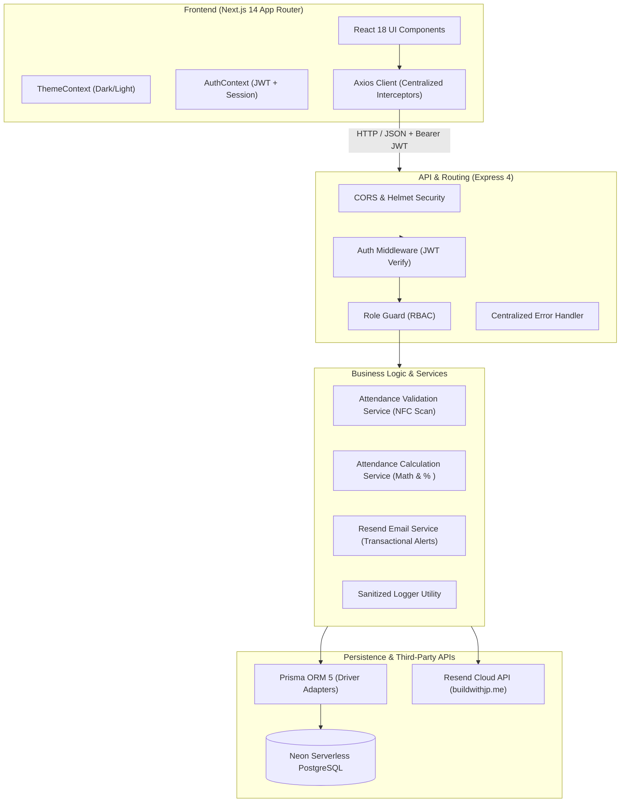
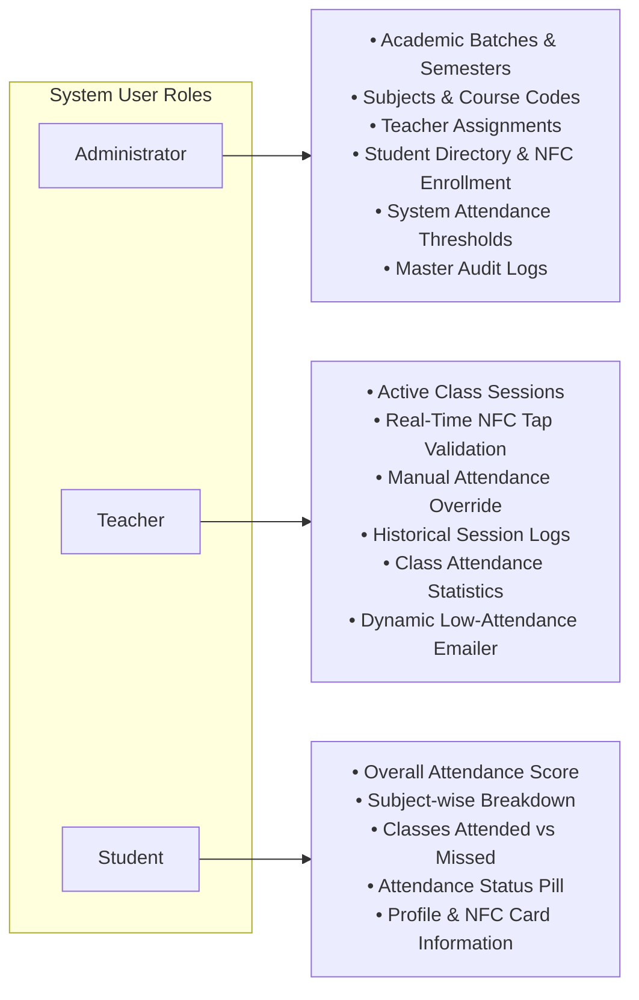
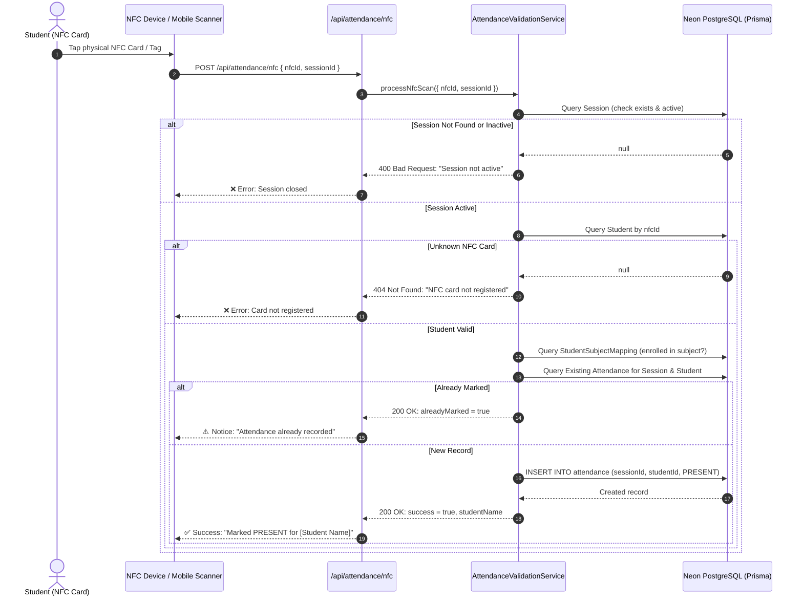
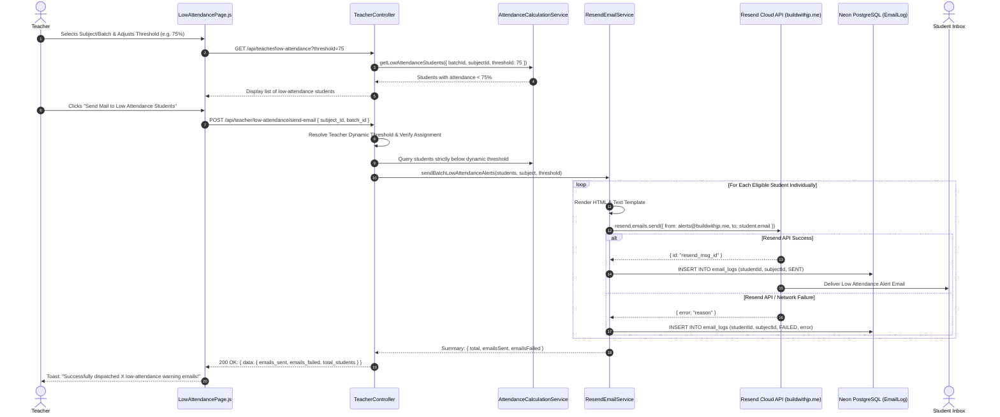
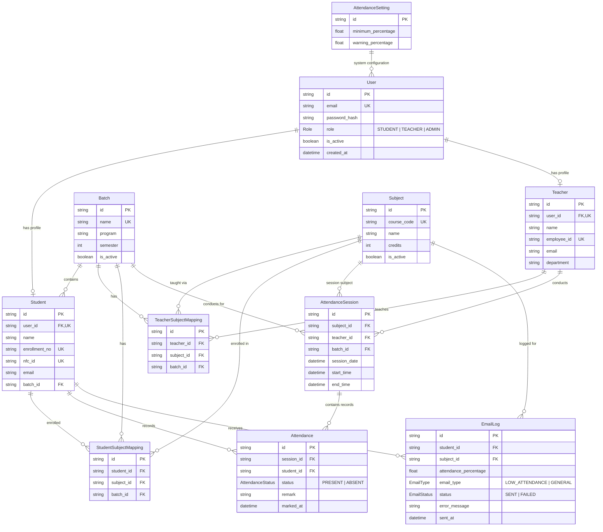

# NFC Attendance Tracker — Complete System Documentation & Architecture Guide

An enterprise-ready, role-based academic attendance tracking system powered by **Near Field Communication (NFC)**, **Next.js 14**, **Node.js/Express**, **Prisma ORM**, **Neon Serverless PostgreSQL**, and **Resend Transactional Email**.

---

## 1. Executive Summary & Core Value Proposition

Traditional academic attendance tracking is plagued by paper sheet circulation, time-consuming manual roll calls, and proxy attendance (friends marking each other).

**NFC Attendance Tracker** solves these challenges by combining:
1. **Physical NFC Token Authentication:** Students tap their encrypted physical NFC card/tag or mobile device to an NFC scanner or teacher's terminal.
2. **Time-Gated Session Windows:** Attendance can only be recorded during an active, teacher-conducted class session within its scheduled time boundary.
3. **Hardware Anti-Proxy Mechanisms:** Instant duplicate scan prevention, strict student-to-NFC mapping, and validation against course enrollments.
4. **Dynamic Low Attendance Early Warning System:** Real-time percentage math with teacher-controlled dynamic thresholds and automated email alerts delivered via **Resend**.
5. **Role-Based Access Control (RBAC):** Distinct dashboards, workflows, and security boundaries for **Admins**, **Teachers**, and **Students**.
6. **Adaptive Design System:** Modern dark and light theme engine with zero-flash persistence and responsive mobile-first UI.

---

## 2. Technology Stack Architecture



| Layer | Technology | Key Responsibility |
|---|---|---|
| **Frontend Framework** | **Next.js 14 (App Router)** | Component-based modular UI, Server/Client components, declarative page routing |
| **Styling & Theme** | **Tailwind CSS + CSS Variables** | Semantic color tokens, Dark Mode / Light Mode with instantaneous zero-reload toggle |
| **State & API** | **React Hooks + Axios Interceptors** | Role-based layout gating, centralized error normalization, bearer token injection |
| **Backend Runtime** | **Node.js (LTS) + Express 4** | Modular REST API, controller-service pattern, sanitized logger, rate safety |
| **ORM & Database** | **Prisma 5 + Neon PostgreSQL** | Cloud-native serverless PostgreSQL, pooled and direct connection handling, relational integrity |
| **Email Service** | **Resend SDK** | Verified custom domain delivery (`alerts@buildwithjp.me`), personalized HTML alerts, failure isolation |
| **Security & Auth** | **JWT (JSON Web Tokens) + BcryptJS** | Stateless authentication, bcrypt salted passwords, scoped route guards |

---

## 3. Role-Based Feature Matrix



### 3.1. Administrator Capabilities
* **Academic Master Data:** Create, update, and manage academic batches (e.g. `2024_MCA`), programs, semesters, and subjects (course code, title, credits).
* **Faculty Allocation:** Map teachers to specific subjects and batches (`teacher_subject_mapping`).
* **Student Onboarding & NFC Card Registration:** Register students, link their unique hardware NFC tag IDs (e.g., `53F391BF140001`), and assign them to batches.
* **Enrollment Management:** Enroll students in required subjects (`student_subject_mapping`).
* **Global Attendance Policies:** Configure default institution-wide minimum attendance threshold (default 75%) and warning threshold (default 80%).

### 3.2. Teacher Capabilities
* **Assigned Course Workspace:** Automatic scoping to only subjects and batches assigned to the logged-in teacher.
* **Attendance Session Creation:** Launch time-bounded attendance sessions with automatic date and duration stamps.
* **Live NFC Attendance Tracking:** Capture card scans with immediate status feedback (Present, Duplicate Tap warning, Unknown Tag rejection).
* **Manual Override & Dispute Handling:** Manually toggle attendance status (`PRESENT` $\leftrightarrow$ `ABSENT`) with remark logging for medical leaves or approved absences.
* **Attendance Analytics:** Statistical summaries per subject, class attendance rate, and attendance distribution.
* **Dynamic Low Attendance Notifications:** Custom threshold filtering (e.g., set to 70%, 75%, 80%) with automated dispatch of individual warning emails via Resend.

### 3.3. Student Capabilities
* **Personal Attendance Overview:** Visual dashboard presenting aggregate attendance percentage across all enrolled subjects.
* **Subject Breakdown:** Per-course metrics showing total lectures conducted, classes attended, classes missed, and compliance status.
* **Threshold Alerts:** Clear visual warning indicators when personal attendance falls below academic criteria.
* **Profile Verification:** View assigned NFC card UID and academic enrollment information.

---

## 4. Key End-to-End System Workflows

### 4.1. NFC Attendance Marking Workflow



### 4.2. Low Attendance Notification & Resend Email Workflow



---

## 5. Database Architecture & Schema

The relational schema is defined in Prisma (`backend/prisma/schema.prisma`) targeting PostgreSQL on Neon Serverless.



---

## 6. Directory Structure

```text
attendance-tracker/
├── backend/
│   ├── prisma/
│   │   ├── schema.prisma                  # Data models, relations, enums & driver adapter settings
│   │   └── seed.js                        # Idempotent database seeder (demo users, courses, demo sessions)
│   ├── src/
│   │   ├── config/
│   │   │   ├── prisma.js                  # Prisma Client instance with environment logging
│   │   │   └── resend.js                  # Resend client initializer, sender resolver (buildwithjp.me)
│   │   ├── controllers/
│   │   │   ├── admin.controller.js        # Admin master data and assignment logic
│   │   │   ├── attendance.controller.js   # Real-time NFC scanning and tap validation
│   │   │   ├── auth.controller.js         # Register, login, getMe controller
│   │   │   ├── student.controller.js      # Student metrics and subject history controller
│   │   │   └── teacher.controller.js      # Teacher sessions, manual overrides & dynamic low attendance
│   │   ├── middleware/
│   │   │   ├── auth.middleware.js         # JWT verification & role authorization guards
│   │   │   └── error.middleware.js        # Centralized HTTP error response normalizer
│   │   ├── routes/
│   │   │   ├── admin.routes.js            # /api/admin/* (Protected: ADMIN)
│   │   │   ├── attendance.routes.js       # /api/attendance/* (Protected: AUTHENTICATED)
│   │   │   ├── auth.routes.js             # /api/auth/* (Public & Token verification)
│   │   │   ├── public.routes.js           # /api/batches, /api/subjects
│   │   │   ├── student.routes.js          # /api/student/* (Protected: STUDENT)
│   │   │   └── teacher.routes.js          # /api/teacher/* (Protected: TEACHER)
│   │   ├── services/
│   │   │   ├── attendanceCalculation.service.js # Dynamic attendance percentage & threshold algorithms
│   │   │   ├── attendanceValidation.service.js  # NFC scan duplicate check & active session verification
│   │   │   └── email.service.js           # Resend batch dispatch, failure isolation & audit tracking
│   │   ├── templates/
│   │   │   └── lowAttendanceEmail.template.js   # Responsive HTML & text email template
│   │   ├── utils/
│   │   │   ├── auth.util.js               # Password hashing (bcrypt) & JWT token generator
│   │   │   ├── email.util.js              # Backward-compatible adapter for email service
│   │   │   ├── errors.js                  # Standardized AppError hierarchy (ValidationError, NotFound, etc.)
│   │   │   └── logger.util.js             # Sanitized structured logging (masks passwords, PII, tokens)
│   │   └── server.js                      # Express application entry point & middleware mounting
│   ├── tests/
│   │   ├── api.test.js                    # End-to-end API integration & business logic suite
│   │   ├── resend_email.test.js           # Resend configuration, template & threshold math test suite
│   │   ├── teacher_email_controller.test.js # Controller threshold caching & contract validation
│   │   └── verify_mobile_integration.js   # Hardware & mobile scanner API contract validator
│   ├── .env                               # Active environment secrets (database URLs, Resend key)
│   ├── .env.example                       # Documented environment template
│   └── package.json                       # Backend dependencies & npm test scripts
│
└── frontend/
    ├── app/
    │   ├── (auth)/
    │   │   ├── login/page.js              # Central login with role auto-routing
    │   │   └── register/page.js           # Student registration with batch selection & NFC tag enrollment
    │   ├── admin/
    │   │   ├── assignments/page.js        # Faculty to course allocation matrix
    │   │   ├── batches/page.js            # Academic batch manager
    │   │   ├── dashboard/page.js          # System metrics and status cards
    │   │   ├── settings/page.js           # Global attendance thresholds editor
    │   │   ├── student-subjects/page.js   # Student subject enrollment manager
    │   │   ├── students/page.js           # Student directory & NFC tag assignments
    │   │   ├── subjects/page.js           # Course codes & subjects manager
    │   │   └── teachers/page.js           # Faculty profile manager
    │   ├── teacher/
    │   │   ├── attendance/
    │   │   │   ├── page.js                # Live class session launcher & NFC card receiver
    │   │   │   ├── history/page.js        # Historical session lookup & manual roll modification
    │   │   │   └── statistics/page.js     # Graphical attendance charts & class distribution
    │   │   ├── dashboard/page.js          # Teacher course overview & quick actions
    │   │   └── low-attendance/page.js     # Dynamic threshold filter & Resend warning email dispatcher
    │   ├── student/
    │   │   ├── attendance/page.js         # Subject-wise attendance breakdown table
    │   │   └── dashboard/page.js          # Student personal metrics, compliance pills & warnings
    │   ├── globals.css                    # Semantic design tokens & Tailwind theme definitions
    │   ├── layout.js                      # Root HTML layout with zero-flash theme bootstrap script
    │   └── page.js                        # Landing page redirecting authenticated users to dashboards
    ├── components/
    │   ├── features/                      # Domain-specific feature modules
    │   │   ├── admin/                     # Admin data tables, edit modals, mapping forms
    │   │   ├── attendance/                # LowAttendanceFilters, LowAttendanceTable, WarningEmailModal
    │   │   ├── auth/                      # LoginForm, RegisterForm, RoleSelector
    │   │   ├── dashboard/                 # MetricCards, StatusOverview, ChartContainer
    │   │   └── student/                   # AttendancePill, SubjectCard, AttendanceSummaryTable
    │   ├── layout/                        # Shared layout scaffolding
    │   │   ├── DashboardLayout.js         # Role-guard shell wrapping Navbar, Sidebar, and Content
    │   │   ├── Navbar.js                  # Header with user profile, role badge & theme toggle
    │   │   ├── Sidebar.js                 # Role-tailored navigation drawer
    │   │   └── PageHeader.js              # Reusable page title with action button slots
    │   └── ui/                            # Atomic, reusable design system components
    │       ├── Button.js                  # Primary, secondary, danger, ghost variants with loading states
    │       ├── Card.js                    # Theme-aware elevated card container
    │       ├── ConfirmModal.js            # Standardized confirmation dialog
    │       ├── EmptyState.js              # Visual fallback for empty lists
    │       ├── ErrorState.js              # Friendly, non-technical error display
    │       ├── Input.js                   # Theme-aware form inputs with validation messages
    │       ├── LoadingSkeleton.js         # Pulsing placeholder for asynchronous loads
    │       ├── Modal.js                   # Accessible dialog overlay
    │       ├── Table.js                   # Responsive data grid with sortable columns
    │       └── Toast.js                   # Non-blocking notification toasts
    ├── context/
    │   ├── AuthContext.js                 # JWT token storage, user profile state & auth lifecycle
    │   └── ThemeContext.js                # Light/Dark mode state with localStorage persistence
    ├── services/
    │   └── api/                           # Centralized API service abstractions
    │       ├── adminApi.js                # Admin endpoints
    │       ├── apiClient.js               # Axios instance with request/response interceptors
    │       ├── attendanceApi.js           # NFC marking and session endpoints
    │       ├── authApi.js                 # Auth endpoints
    │       ├── publicApi.js               # Batches and subjects
    │       ├── studentApi.js              # Student metrics and history
    │       └── teacherApi.js              # Teacher sessions, assignments & low-attendance emailer
    ├── utils/
    │   └── errorHandler.js                # Sanitizes raw errors into user-friendly UI messages
    ├── tailwind.config.js                 # Tailwind CSS configuration with darkMode: 'class'
    └── package.json                       # Frontend dependencies & Next.js scripts
```

---

## 7. REST API Specifications

### 7.1. Authentication (`/api/auth`)
* `POST /api/auth/register` — Registers a new student account, hashes password, links NFC tag ID, and assigns batch.
* `POST /api/auth/login` — Authenticates email and password, returns signed JWT token and user profile.
* `GET /api/auth/me` — Returns profile details for the bearer token holder.

### 7.2. Attendance Marking (`/api/attendance`)
* `POST /api/attendance/nfc` — Records attendance via hardware card scan.
  * **Payload:** `{ "nfcId": "53F391BF140001", "sessionId": "uuid" }`
  * **Validation:** Active session boundary $\rightarrow$ Registered card $\rightarrow$ Enrolled student $\rightarrow$ Duplicate tap check.

### 7.3. Teacher Operations (`/api/teacher`)
* `GET /api/teacher/subjects` — Lists distinct active subjects assigned to the teacher.
* `GET /api/teacher/batches` — Lists distinct batches assigned to the teacher.
* `GET /api/teacher/assignments` — Complete course-batch allocation list with enrolled student rosters.
* `POST /api/teacher/attendance-sessions` — Creates a new active class attendance session.
* `GET /api/teacher/attendance-sessions` — Lists conducted attendance sessions with filters.
* `GET /api/teacher/attendance-sessions/:id` — Detailed session roster with present/absent student records.
* `PATCH /api/teacher/attendance/:id` — Manual attendance override (toggle `PRESENT` / `ABSENT` with remarks).
* `GET /api/teacher/attendance/statistics` — Calculated metrics on attendance rates across assignments.
* `GET /api/teacher/low-attendance` — Evaluates students against dynamic query threshold (e.g. `?threshold=75`).
* `POST /api/teacher/low-attendance/send-email` — Dispatches individualized low-attendance email warnings via Resend.
  * **Payload:** `{ "subject_id": "uuid", "batch_id": "uuid", "threshold"?: number }`
  * **Response:** `{ "data": { "total_students_evaluated": 15, "total_low_attendance_students": 2, "emails_sent": 2, "emails_failed": 0 } }`

### 7.4. Student Operations (`/api/student`)
* `GET /api/student/profile` — Returns student profile, batch info, and NFC card UID.
* `GET /api/student/attendance/summary` — Returns overall percentage, attended/missed counts, and per-subject breakdown.
* `GET /api/student/attendance` — Paginated date-wise log of every session conducted and student's status.

### 7.5. Admin Operations (`/api/admin`)
* Full CRUD endpoints for `/users`, `/teachers`, `/students`, `/batches`, `/subjects`, `/teacher-subject-mappings`, and `/student-subject-mappings`.

---

## 8. Theme System & UI Design Principles

### Semantic CSS Token System
The application uses CSS variables defined in [`frontend/app/globals.css`](file:///d:/NFC_Attendence_Tracker/attendance-tracker/frontend/app/globals.css) and wired into Tailwind CSS:

| Token | Light Theme | Dark Theme | Purpose |
|---|---|---|---|
| `background` | `#f8fafc` (Slate 50) | `#020617` (Slate 950) | Canvas body background |
| `surface` / `card` | `#ffffff` (Pure White) | `#0f172a` (Slate 900) | Card & container panels |
| `border` | `#e2e8f0` (Slate 200) | `#1e293b` (Slate 800) | Subtle separation lines |
| `primary` | `#2563eb` (Blue 600) | `#3b82f6` (Blue 500) | Brand accents & primary buttons |
| `text-primary` | `#0f172a` (Slate 900) | `#f8fafc` (Slate 50) | Headings & primary typography |
| `text-secondary` | `#64748b` (Slate 500) | `#94a3b8` (Slate 400) | Subtitles, labels, and timestamps |

### Zero-Flash Loading Script
To prevent "flash of unstyled/wrong theme" (FOUC), an inline execution script in `RootLayout` reads `localStorage.getItem('theme')` or system `prefers-color-scheme` synchronously before DOM paint, adding or removing the `dark` class instantly.

---

## 9. Testing & Quality Assurance

The codebase includes automated test suites covering all business logic:
* `npm run test:email --prefix backend` — Verifies Resend SDK configuration, sender domain resolution (`alerts@buildwithjp.me`), HTML template rendering, error isolation (failed student does not block others), and dynamic threshold math ($30\%, 60\%, 74\% < 75\%$ eligible; $75\%, 80\% \ge 75\%$ excluded). (41/41 Passing).
* `node backend/tests/teacher_email_controller.test.js` — Verifies controller threshold caching and response schema compliance (8/8 Passing).
* `node backend/tests/api.test.js` — Verifies JWT authentication, bcrypt hashing, database schema relations, and attendance calculation math.
* `npm run test:mobile-api --prefix backend` — Verifies hardware NFC scanner API payload contract and duplicate scan rejection.

